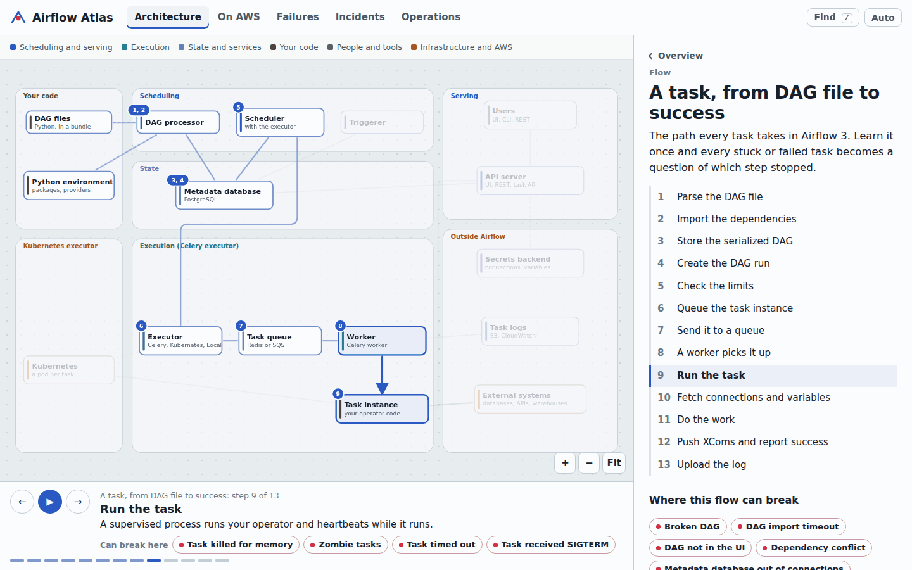
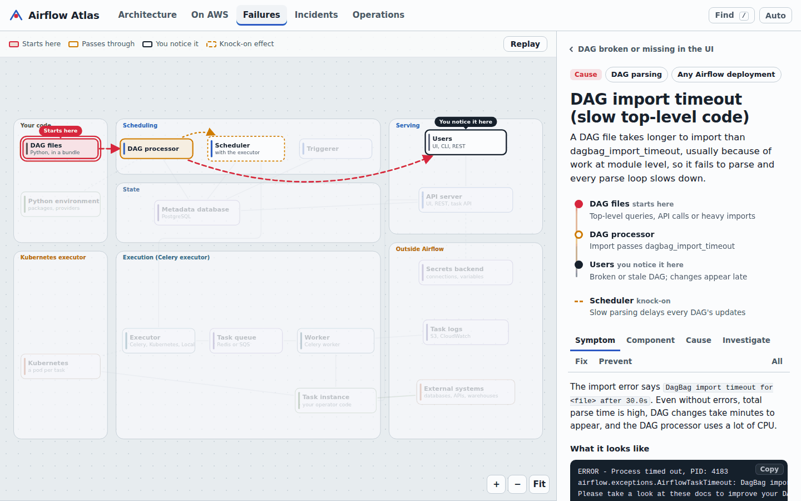
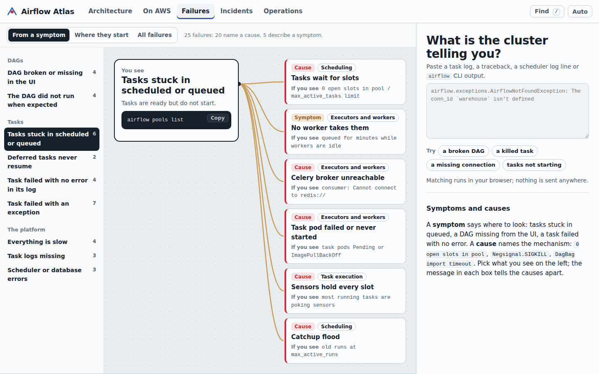
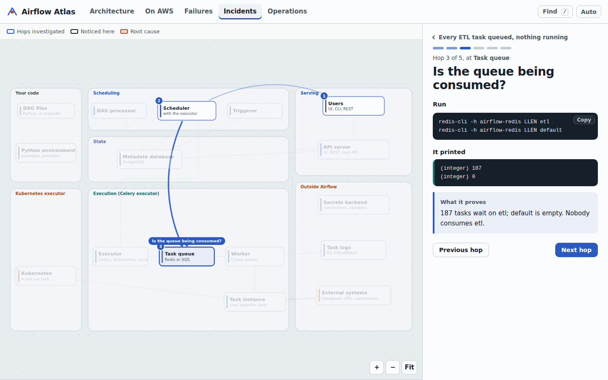
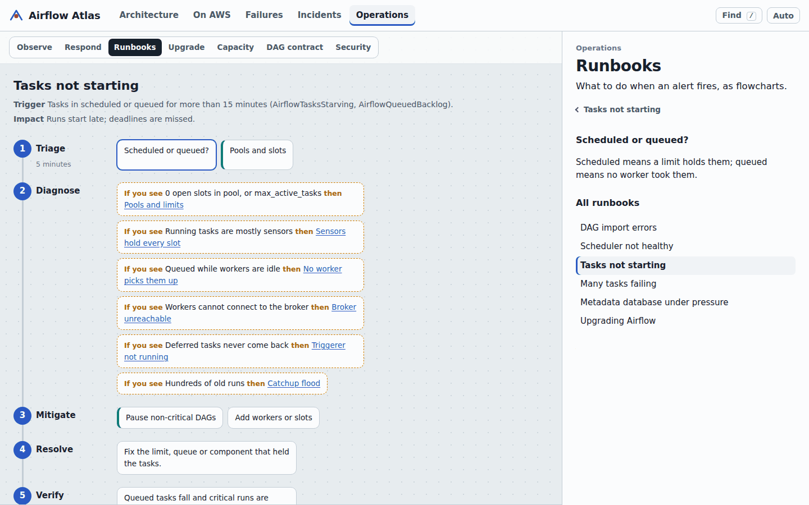
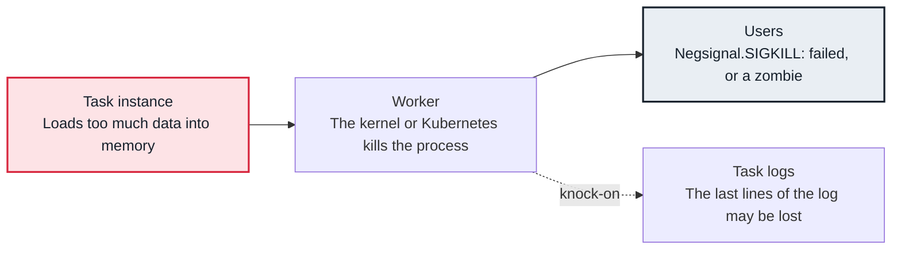
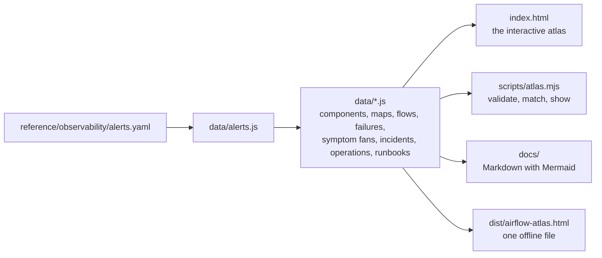

# Airflow Atlas

**Apache Airflow and Amazon MWAA, drawn as a map you can click.** See what every part of an Airflow 3 deployment does and how a task travels from a DAG file to success, play animated flows, and watch each of 25 production failures travel from where it starts to where you notice it.



Open `index.html` in a browser. There is no build step, no server and no dependency, and nothing you paste leaves your machine.

## What's inside

| View | What you can do there |
|---|---|
| **Architecture** | Explore an Airflow 3 deployment as a map: DAG files and the Python environment, the DAG processor, scheduler and triggerer, the metadata database, the executor, Celery queue and workers, Kubernetes pods, the API server and its Task Execution API, secrets, logs and the systems tasks call. Click any part to see how it works inside, what it connects to and which failures start there. Play four flows: a task from DAG file to success, a deferrable sensor, a worker dying mid-task, and unpausing a DAG with catchup. |
| **Airflow on AWS** | Amazon MWAA in your VPC through five lenses: networking, security (execution role, Secrets Manager), code and dependencies (S3, requirements.txt), deployment (MWAA, the Helm chart on EKS) and observability. Two flows, decision tables, a production layout and a worker sizing calculator. |
| **Failures** | 25 failures, each with the six parts: symptom, affected component, root cause, investigation, resolution and prevention. Every one is animated on the map: red where it starts, amber where it passes through, a marker where you notice it, dashed knock-on effects. Start from what you see (9 symptom fans), from where failures begin (a heat map), or paste a task log or traceback. |
| **Incidents** | Three production investigations replayed hop by hop: tasks queued on a queue no worker read, a night of zombies caused by one memory-hungry task, and Glue calls timing out after a NAT gateway was removed. |
| **Operations** | Signals and when to page, the investigation loop and the first fifteen minutes, six runbooks drawn as flowcharts, upgrading Airflow, sizing, the production DAG contract (a real DAG, explained line by line) and the security layers. |

| | |
|---|---|
|  |  |
| A failure travels across the map from its cause to its symptom. | Start from what you see; the tell in each box separates the causes. |
|  |  |
| Incidents replay hop by hop, each with its command and finding. | Runbooks are flowcharts; every step opens its commands. |

## How a failure is drawn

Every failure records the path it takes through the system, so the same data drives the animation in the atlas and the diagram on its Markdown page. A task killed for memory, for example:



Tasks stuck in queued, a DAG missing from the UI or a task failed with no error are **symptoms**: they tell you where to look. Messages such as `0 open slots in pool`, `Negsignal.SIGKILL` or `DagBag import timeout` name a **cause**. The catalog marks each entry as one or the other, and the matcher ranks causes above the symptoms they produce.

## Use it during an incident

- **Paste the task log.** In Failures, paste a traceback, a scheduler log line or `airflow` CLI output; the best match opens with its path drawn on the map.
- **Share a link.** Every view, selection and step has its own address, for example `index.html#/failures/zombie-tasks?tab=investigate` or `index.html#/incidents/queue-mismatch/3`.
- **Stay in the terminal.**

  ```sh
  airflow tasks logs ... | node scripts/atlas.mjs match
  node scripts/atlas.mjs show pool-slots-exhausted
  tools/snapshot.sh orders_daily        # read-only snapshot of the deployment
  ```

- **Work offline.** `npm run build` writes `dist/airflow-atlas.html`, one file you can keep on a laptop. Remove the three font lines in `index.html` and the atlas makes no network requests at all.
- **Read it as Markdown.** [`docs/failures/`](docs/failures/README.md), [`docs/runbooks/`](docs/runbooks/README.md) and [`docs/incidents.md`](docs/incidents.md) are generated from the same data, with Mermaid diagrams that GitHub renders.

## For your own DAGs

- [`reference/dags/orders_daily.py`](reference/dags/orders_daily.py) is a production DAG that follows the contract shown in Operations: deferrable sensors, timeouts, pools, retries, catchup off and small XComs.
- [`reference/ci/test_dag_integrity.py`](reference/ci/test_dag_integrity.py) is a pytest suite to run in your CI: no import errors, import time under a budget, retries and timeouts on every task, catchup only where intended.
- [`reference/`](reference/README.md) also holds production settings, Helm values for EKS, MWAA requirements and a least-privilege execution role, and Prometheus alert rules that link back to the failure pages.

## Practise on your laptop

```sh
pip install "apache-airflow==3.0.6" --constraint "https://raw.githubusercontent.com/apache/airflow/constraints-3.0.6/constraints-3.12.txt"
export AIRFLOW_HOME=$PWD/.airflow && airflow standalone
cp labs/dags/lab_timeout.py $AIRFLOW_HOME/dags/
airflow dags test lab_timeout
```

Six DAGs in [`labs/`](labs/README.md) reproduce import errors, slow parsing, full pools, timeouts, missing connections and memory kills.

## How it is built



The data files are the single source of truth. The browser loads them as plain scripts, which is why the atlas works from `file://` and on GitHub Pages without a build. `scripts/atlas.mjs` loads exactly the files `index.html` lists, so the site, the docs and the command line cannot disagree. Validation checks every cross-reference, checks that every sample message matches its own entry first, and checks the map geometry: no station may overlap another and no connection may run through a station.

## Repository structure

```text
index.html                 the atlas: open it in a browser
assets/                    styles, the SVG map renderer, the flow player and the views
data/                      the source of truth: components, maps, flows, failures, triage, incidents, operations
docs/                      generated Markdown: failure pages, runbooks, incidents
labs/dags/                 small DAGs that reproduce failures on a local Airflow
reference/                 a production DAG, a DAG integrity test, settings, Helm, MWAA, alert rules
tools/snapshot.sh          a read-only snapshot of a deployment for incident channels
scripts/atlas.mjs          validate, generate docs, build one file, match, show
tests/                     unit tests and a browser smoke test
```

The examples follow Larder, a fictional grocery delivery company running Airflow on Amazon MWAA and on EKS.

## Development

The atlas tooling needs Node 20 or later and nothing else; the labs and the reference tests need Python and Airflow.

```sh
npm test                 # data integrity, matcher, layout, generated files, Markdown safety
npm run check            # validation, plus generated files are current (CI runs this)
npm run docs             # regenerate docs/ after editing data
npm run build            # dist/airflow-atlas.html
npm install --no-save playwright && npx playwright install chromium
npm run test:browser     # render every view and all 25 failures in Chromium
```

Pushes to `main` publish the atlas to GitHub Pages through `.github/workflows/pages.yml` (set the Pages source to GitHub Actions).

## Contributing

Add a failure, a component, a flow or an incident by editing the data; [CONTRIBUTING.md](CONTRIBUTING.md) shows the shape of each and what validation expects. The most valuable contribution is a failure your own DAGs taught you about.

## Credits

Larder is fictional; account IDs, ARNs, hostnames and figures are examples. The interface uses Overpass, a typeface drawn from highway signage by Delve Withrington, under the SIL Open Font License, loaded from Google Fonts with system fonts as the fallback. Apache Airflow and Airflow are trademarks of the Apache Software Foundation. AWS, Amazon MWAA and related names are trademarks of Amazon.com, Inc. or its affiliates. This project is not affiliated with either.
