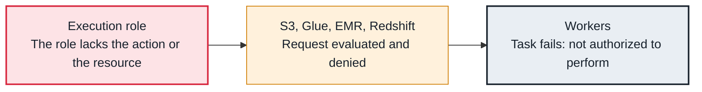

<!-- Generated from data/failures/aws.js by `node scripts/atlas.mjs docs`. Edit the data, then regenerate. -->

# AccessDenied from AWS (execution role)

A task calls an AWS service and is refused, because the execution role (or the task's connection) is not allowed to perform that action on that resource.

| Kind | Layer | Scope | Interactive |
|---|---|---|---|
| Cause | AWS | On AWS | [Open in the atlas](../../index.html#/failures/aws-access-denied) |

## How it propagates



## Symptom

The task fails with `AccessDeniedException ... is not authorized to perform: <service>:<action> on resource: <arn>`. The same DAG works in another environment.

## Affected component

The **execution role**'s policies; the **AWS service** evaluates and denies; the **worker** reports it.

## Root cause

On MWAA every task runs with the execution role unless its connection supplies other credentials. A new operator, a new bucket or job, a resource in another account, or a KMS key on the data each need permissions the role does not have yet.

## Investigation

1. **Which identity, action and resource?**

   ```sh
   grep -E 'not authorized to perform' task.log
   ```

   Look for: The assumed role, the action and the resource ARN named in the message.

2. **Simulate the policy**

   ```sh
   aws iam simulate-principal-policy --policy-source-arn $ROLE_ARN --action-names glue:StartJobRun --resource-arns arn:aws:glue:eu-west-1:123456789012:job/orders-transform --query 'EvaluationResults[].EvalDecision'
   ```

   Look for: implicitDeny or explicitDeny.

## Resolution

Add the action on the specific resource to the execution role (or the role in the task's AWS connection), including KMS permissions for encrypted data and a bucket policy for cross-account access. Review the change with the DAG that needs it.

## Prevention

- Keep the execution role in code next to the DAGs that use it.
- Least privilege per environment; separate environments rather than widen one role.
- Test new AWS calls in a staging environment with the same role.

## Related

- [Cannot read connections from Secrets Manager](secrets-access-denied.md)
- [Tasks time out calling AWS](aws-endpoint-timeout.md)

## Runbooks

- [Many tasks failing](../runbooks/failing-tasks.md)
