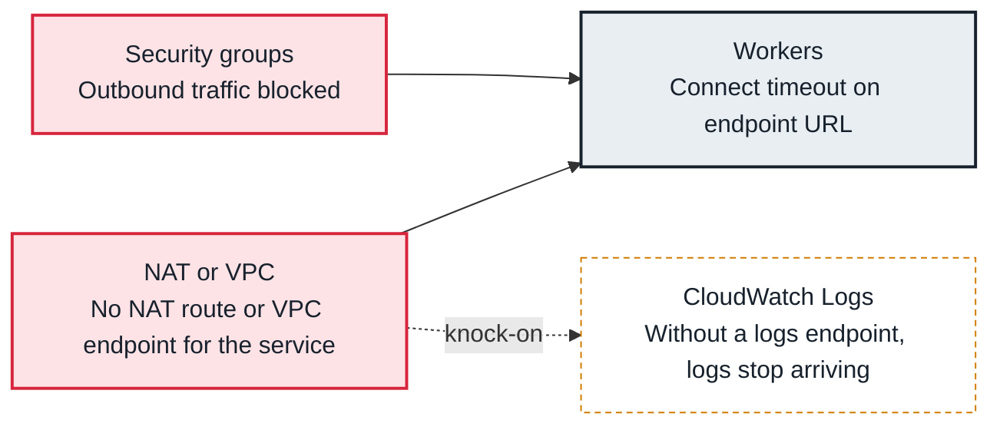

<!-- Generated from data/failures/aws.js by `node scripts/atlas.mjs docs`. Edit the data, then regenerate. -->

# Tasks time out calling AWS (no network path)

Tasks in private subnets cannot reach an AWS service or the internet: no NAT gateway, no VPC endpoint for that service, or outbound traffic blocked.

| Kind | Layer | Scope | Interactive |
|---|---|---|---|
| Cause | AWS | On AWS | [Open in the atlas](../../index.html#/failures/aws-endpoint-timeout) |

## How it propagates



## Symptom

Tasks hang, then fail with `ConnectTimeoutError: Connect timeout on endpoint URL: "https://glue.eu-west-1.amazonaws.com/"` (or a timeout to an external API). Calls to some services work, to others they do not.

## Affected component

The network path out of the private subnets: **NAT or VPC endpoints** and **security groups**; the **workers** report it.

## Root cause

MWAA runs in private subnets. Every service a task calls needs either a NAT gateway route or a VPC endpoint. Environments built without internet access usually have endpoints for MWAA's own needs (S3, SQS, CloudWatch, KMS) but not for Glue, Redshift, Secrets Manager or third-party APIs.

## Investigation

1. **Which endpoints exist?**

   ```sh
   aws ec2 describe-vpc-endpoints --filters Name=vpc-id,Values=$VPC --query 'VpcEndpoints[].ServiceName'
   ```

   Look for: The service the task calls missing from the list.

2. **Is there a default route to NAT?**

   ```sh
   aws ec2 describe-route-tables --filters Name=association.subnet-id,Values=$SUBNET --query 'RouteTables[].Routes[]'
   ```

   Look for: A 0.0.0.0/0 route to a NAT gateway, or none.

## Resolution

Add an interface endpoint for the service (and allow HTTPS from the environment's security group on the endpoint), or a NAT gateway route for internet destinations. Then retry the failed tasks.

## Prevention

- List every service DAGs call and keep endpoints or NAT for each in the network code.
- Set client timeouts shorter than execution_timeout so failures are quick and clear.
- Test new integrations in staging with the same network.

## Related

- [AccessDenied from AWS](aws-access-denied.md)
- [Task timed out](execution-timeout.md)

## Runbooks

- [Many tasks failing](../runbooks/failing-tasks.md)
