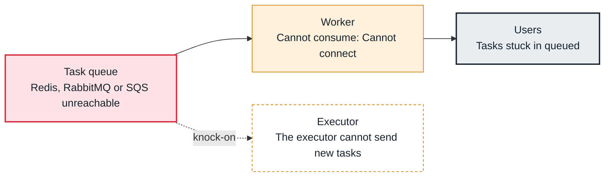

<!-- Generated from data/failures/workers.js by `node scripts/atlas.mjs docs`. Edit the data, then regenerate. -->

# Celery broker unreachable

Workers or the executor cannot reach the Celery broker (Redis, RabbitMQ or SQS), so queued tasks are never delivered.

| Kind | Layer | Scope | Interactive |
|---|---|---|---|
| Cause | Executors and workers | Any Airflow deployment | [Open in the atlas](../../index.html#/failures/broker-unavailable) |

## How it propagates



## Symptom

Worker logs repeat `consumer: Cannot connect to redis://...: Connection refused` and 'Trying again in N seconds'. Tasks stay queued across every DAG at once.

## Affected component

The **broker** itself, or the path to it; **workers** cannot consume and the **executor** cannot publish while it is unreachable.

## Root cause

The broker restarted or was replaced (a new address, a failover), ran out of memory and evicts or refuses writes, or the network path or credentials changed. Redis without persistence also loses queued tasks when it restarts.

## Investigation

1. **Can workers reach it?**

   ```sh
   redis-cli -h airflow-redis ping
   kubectl logs deploy/airflow-worker -n airflow --tail=20 | grep -i 'cannot connect'
   ```

   Look for: No PONG, or connection errors with the address the workers use.

2. **Is the broker healthy?**

   ```sh
   redis-cli -h airflow-redis info memory | grep -E 'used_memory_human|maxmemory_human'
   redis-cli -h airflow-redis info persistence | grep -E 'rdb_last_bgsave_status|aof_enabled'
   ```

   Look for: Memory at its limit, or no persistence, so queued tasks vanish on restart.

## Resolution

Restore the broker or point workers and the scheduler at the right address, then restart workers so they reconnect. Tasks lost from a non-persistent broker are failed by task_queued_timeout and retried.

## Prevention

- Use a managed, highly available broker, or SQS.
- Alert on worker connection errors and broker memory.
- Keep the broker address in one configuration value shared by all components.

## Related

- [Tasks stuck in queued](tasks-stuck-queued.md)

## Runbooks

- [Tasks not starting](../runbooks/tasks-not-running.md)
