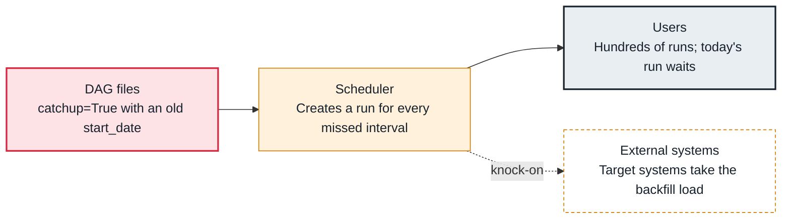

<!-- Generated from data/failures/scheduling.js by `node scripts/atlas.mjs docs`. Edit the data, then regenerate. -->

# Catchup flood (hundreds of runs for old dates)

A DAG is unpaused with catchup on and an old start_date, so the scheduler creates a run for every missed interval and they crowd out today's work.

| Kind | Layer | Scope | Interactive |
|---|---|---|---|
| Cause | Scheduling | Any Airflow deployment | [Open in the atlas](../../index.html#/failures/catchup-flood) |

## How it propagates



## Symptom

Right after a DAG is unpaused or its start_date changes, the grid fills with runs for past dates. Scheduler logs say the DAG 'is at (or above) max_active_runs'. Today's run waits behind them, and pools and targets are saturated.

## Affected component

The **scheduler** creates the runs; the setting is in the **DAG file**; the **external systems** absorb the load.

## Root cause

With catchup enabled, the scheduler creates one run for every data interval between start_date and now that has no run yet. Airflow 3 defaults catchup to False, but DAGs that set catchup=True, or older configuration that changes the default, still flood when unpaused late.

## Investigation

1. **How many runs, for which dates?**

   ```sh
   airflow dags list-runs orders_daily --state queued | head
   airflow dags details orders_daily | grep -E 'catchup|start_date|max_active_runs'
   ```

   Look for: Many queued runs for old logical dates, and catchup True.

2. **Who unpaused it, and when?**

   ```sh
   # UI: Browse > Audit Log, filtered to the DAG
   ```

   Look for: The unpause or start_date change that started the flood.

## Resolution

Pause the DAG, mark the unwanted runs as failed or delete them, set catchup=False (or a recent start_date), and unpause. Run real backfills deliberately with `airflow backfill create` and a small max_active_runs.

## Prevention

- Set catchup explicitly in every DAG.
- Review start_date changes like schema changes.
- Use backfills, not catchup, for historical loads.

## Related

- [Tasks wait for slots](pool-slots-exhausted.md)

## Runbooks

- [Tasks not starting](../runbooks/tasks-not-running.md)
