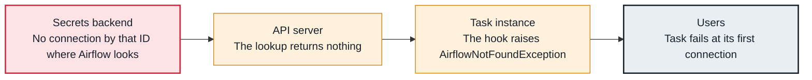

<!-- Generated from data/failures/connections.js by `node scripts/atlas.mjs docs`. Edit the data, then regenerate. -->

# Connection not defined (conn_id isn't defined)

A task asks for a connection ID that does not exist where Airflow looks: not in the secrets backend, the environment, or the database.

| Kind | Layer | Scope | Interactive |
|---|---|---|---|
| Cause | Connections | Any Airflow deployment | [Open in the atlas](../../index.html#/failures/connection-not-found) |

## How it propagates



## Symptom

The task fails immediately with `AirflowNotFoundException: The conn_id `warehouse` isn't defined`. It works on another environment or a laptop.

## Affected component

The **secrets backend** (or environment variables, or the database) has no such connection; the **task** fails when its hook asks for it through the **API server**.

## Root cause

Connections are looked up by ID at run time: secrets backend first, then environment variables, then the metadata database. A typo in conn_id, a connection created in one environment only, a secret stored under another name or prefix (airflow/connections/<id> by default), or the backend not configured on this environment all end here.

## Investigation

1. **Can Airflow see it here?**

   ```sh
   airflow connections get warehouse -o json
   ```

   Look for: Not found means none of the backends has it.

2. **Where should it come from?**

   ```sh
   airflow config get-value secrets backend
   airflow config get-value secrets backend_kwargs
   aws secretsmanager list-secrets --filters Key=name,Values=airflow/connections/ --query 'SecretList[].Name'
   ```

   Look for: The configured prefix, and whether a secret with exactly that ID exists.

## Resolution

Create the connection where this environment reads it (for example the secret `airflow/connections/warehouse` in Secrets Manager), or fix the conn_id in the DAG. Prefer one source per environment so connections do not exist in some places only.

## Prevention

- Keep connections in a secrets backend, defined as code per environment.
- Check that every conn_id used in DAGs exists, in CI or a deploy step.
- Use the same conn_ids in every environment, with different values.

## Related

- [Cannot read connections from Secrets Manager](secrets-access-denied.md)

## Runbooks

- [Many tasks failing](../runbooks/failing-tasks.md)

## Reproduce it locally

```sh
cp labs/dags/lab_missing_connection.py $AIRFLOW_HOME/dags/
airflow dags test lab_missing_connection
```

These run on a local Airflow: see [labs/](../../labs/README.md).
