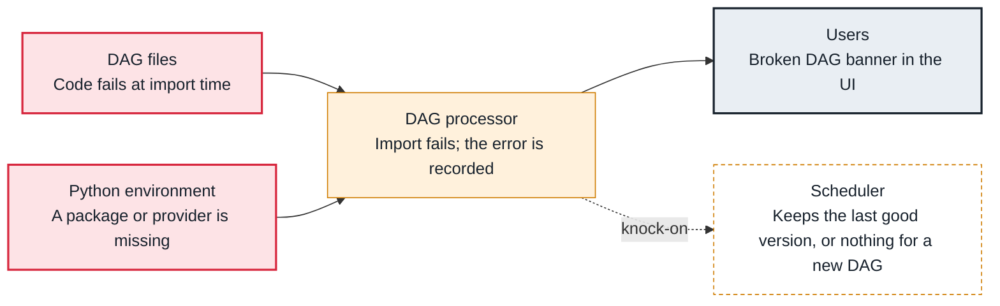

<!-- Generated from data/failures/parsing.js by `node scripts/atlas.mjs docs`. Edit the data, then regenerate. -->

# Broken DAG (import error)

A DAG file raises an exception when imported: a missing package, a syntax error, or code at module level that fails. The DAG is not updated, or never appears.

| Kind | Layer | Scope | Interactive |
|---|---|---|---|
| Cause | DAG parsing | Any Airflow deployment | [Open in the atlas](../../index.html#/failures/dag-import-error) |

## How it propagates



## Symptom

The UI shows 'Broken DAG' with a traceback, or `airflow dags list-import-errors` lists the file. A new DAG never appears; an existing one keeps its last good version while changes are ignored.

## Affected component

The **DAG processor** imports the file and records the error; the cause is in the **DAG file** or the **Python environment** it imports from.

## Root cause

Every DAG file is a Python module imported again and again. Anything that fails at import time breaks it: a provider that is not installed on the DAG processor, a syntax error, a variable or connection read at module level that does not exist, a file path that only exists on a laptop.

## Investigation

1. **Read the recorded error**

   ```sh
   airflow dags list-import-errors
   ```

   Look for: The file and the last line of the traceback.

2. **Reproduce it where the DAG processor runs**

   ```sh
   python -c "import runpy; runpy.run_path('/opt/airflow/dags/orders_daily.py')"
   ```

   Look for: The same exception, with the full traceback.

## Resolution

Fix the import: add the missing provider to the requirements (with the constraints file), move work out of module level into tasks, and read Variables and connections inside tasks or templates. Deploy the fix; the next parse clears the error.

## Prevention

- Import every DAG in CI with the production requirements (a DAG integrity test).
- No Variable.get, database or API calls at module level.
- Alert on dag_processing.import_errors above zero.

## Related

- [Dependency conflict](dependency-conflict.md)
- [DAG import timeout](dag-processing-timeout.md)

## Runbooks

- [DAG import errors](../runbooks/dag-import-errors.md)

## Reproduce it locally

```sh
cp labs/dags/lab_broken_import.py $AIRFLOW_HOME/dags/
airflow dags reserialize
airflow dags list-import-errors
```

These run on a local Airflow: see [labs/](../../labs/README.md).
