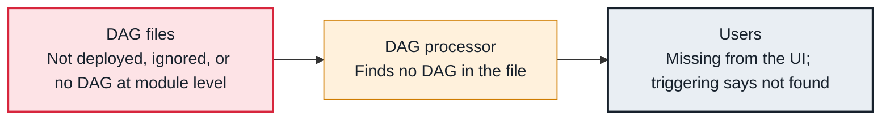

<!-- Generated from data/failures/parsing.js by `node scripts/atlas.mjs docs`. Edit the data, then regenerate. -->

# DAG not in the UI (and no import error)

A DAG never shows up, with no error to explain it: the file is not in the bundle, it is ignored, or the DAG object is never created at module level.

| Kind | Layer | Scope | Interactive |
|---|---|---|---|
| Symptom | DAG parsing | Any Airflow deployment | [Open in the atlas](../../index.html#/failures/dag-not-appearing) |

## How it propagates



## Symptom

The DAG is absent from the UI and from `airflow dags list`, and there is no import error. Triggering it fails with `Dag id <id> not found in DagModel`.

## Affected component

The **DAG processor** parsed the file, or skipped it, and found no DAG; the cause is in the **DAG files** or how they are deployed.

## Root cause

Common causes: the file never reached the DAG bundle (a deploy that copied the wrong folder); `.airflowignore` matches it; safe mode skips files that contain neither 'airflow' nor 'dag'; the decorated function is never called (`@dag def orders(): ...` without `orders()`); or two files define the same dag_id and one wins.

## Investigation

1. **Is the file where the DAG processor reads?**

   ```sh
   airflow dags list --columns dag_id,fileloc | grep orders
   ls $AIRFLOW_HOME/dags/ && cat $AIRFLOW_HOME/dags/.airflowignore
   ```

   Look for: The file present, not ignored, and the dag_id listed.

2. **Does importing the file create a DAG?**

   ```sh
   python -c "import runpy; m = runpy.run_path('dags/orders_daily.py'); print([k for k, v in m.items() if type(v).__name__ == 'DAG'])"
   ```

   Look for: An empty list means the DAG is never created at module level.

## Resolution

Deploy the file to the bundle, fix the ignore pattern, call the decorated DAG function at module level, and give every DAG a unique dag_id. Wait one parse interval or run `airflow dags reserialize`.

## Prevention

- A CI test that imports the bundle and asserts the expected dag_ids exist.
- Deploy DAGs from CI to the bundle, never by hand.
- Check for duplicate dag_ids in the same test.

## Related

- [Broken DAG](dag-import-error.md)

## Runbooks

- [DAG import errors](../runbooks/dag-import-errors.md)
