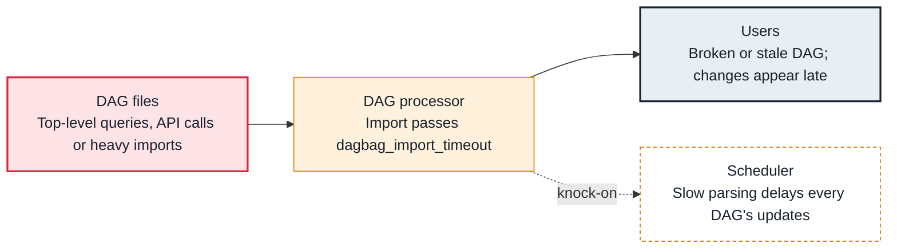

<!-- Generated from data/failures/parsing.js by `node scripts/atlas.mjs docs`. Edit the data, then regenerate. -->

# DAG import timeout (slow top-level code)

A DAG file takes longer to import than dagbag_import_timeout, usually because of work at module level, so it fails to parse and every parse loop slows down.

| Kind | Layer | Scope | Interactive |
|---|---|---|---|
| Cause | DAG parsing | Any Airflow deployment | [Open in the atlas](../../index.html#/failures/dag-processing-timeout) |

## How it propagates



## Symptom

The import error says `DagBag import timeout for <file> after 30.0s`. Even without errors, total parse time is high, DAG changes take minutes to appear, and the DAG processor uses a lot of CPU.

## Affected component

The **DAG processor** gives up on the file; the cause is code at module level in the **DAG file**.

## Root cause

Module-level code runs on every parse, by default every 30 seconds per file. A database query to build tasks dynamically, an HTTP call, reading a large file or importing heavy libraries (pandas, ML frameworks) at the top of the file multiplies across every parse and every file.

## Investigation

1. **Which files are slow?**

   ```sh
   airflow dags report
   ```

   Look for: The duration column: files taking seconds instead of milliseconds.

2. **What makes the import slow?**

   ```sh
   python -X importtime /opt/airflow/dags/reports.py 2> imports.txt; sort -t'|' -k2 -n imports.txt | tail
   ```

   Look for: Heavy imports, and module-level calls in the file itself.

## Resolution

Move work into tasks: query inside a task (or use dynamic task mapping) instead of at module level, import heavy libraries inside the task functions, and cache any configuration the DAG shape depends on in a file shipped with the code. Raise dagbag_import_timeout only as a stopgap.

## Prevention

- Measure import time per DAG in CI and fail above a budget (for example 2 seconds).
- Keep imports of heavy libraries inside task functions.
- Alert on dag_processing.total_parse_time.

Alerts that lead here: `AirflowDagParsingSlow` (ticket).

## Related

- [Broken DAG](dag-import-error.md)

## Runbooks

- [DAG import errors](../runbooks/dag-import-errors.md)

## Reproduce it locally

```sh
cp labs/dags/lab_slow_parse.py $AIRFLOW_HOME/dags/
airflow dags report
```

These run on a local Airflow: see [labs/](../../labs/README.md).
