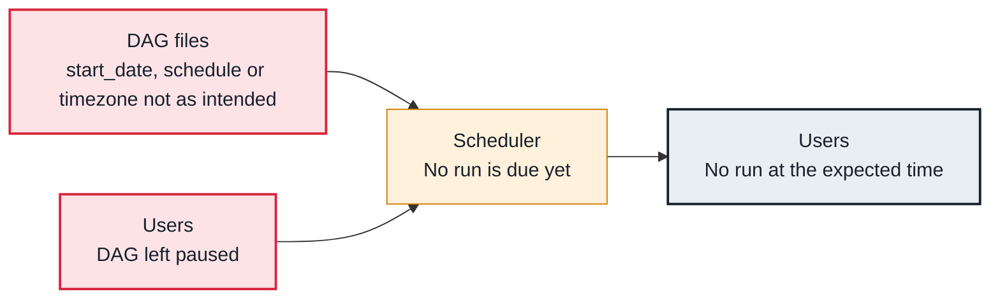

<!-- Generated from data/failures/scheduling.js by `node scripts/atlas.mjs docs`. Edit the data, then regenerate. -->

# DAG did not run when expected

No run appears at the time you expected: the DAG is paused, the schedule runs at the end of the data interval, the start_date is in the future, or the timezone is not what you think.

| Kind | Layer | Scope | Interactive |
|---|---|---|---|
| Symptom | Scheduling | Any Airflow deployment | [Open in the atlas](../../index.html#/failures/dag-run-not-triggered) |

## How it propagates



## Symptom

The expected run never appears, or appears a day later than expected. There are no errors anywhere.

## Affected component

The **scheduler** creates runs exactly as the **DAG file** and its paused state say; the misunderstanding is usually in the schedule.

## Root cause

A run for a data interval is created when that interval ends: a daily DAG's run for Monday starts on Tuesday at the scheduled time. DAGs are created paused by default (dags_are_paused_at_creation). A start_date in the future, a cron expression read in UTC while you think in local time, or a timetable that skips the date also explain silence.

## Investigation

1. **Is it paused, and when is the next run?**

   ```sh
   airflow dags details orders_daily | grep -E 'is_paused|next_dagrun|timezone|schedule'
   airflow dags next-execution orders_daily
   ```

   Look for: is_paused True, or a next run later than you expected.

2. **What did the last runs cover?**

   ```sh
   airflow dags list-runs orders_daily | head
   ```

   Look for: The logical dates and data intervals of recent runs, against what you expected.

## Resolution

Unpause the DAG, and state the schedule in the DAG's timezone with a pendulum start_date. If you want a run at the start of the interval, adjust the cron expression or use a timetable that does that. Trigger a manual run if today's is needed now.

## Prevention

- Write the intended first run in a comment next to start_date and schedule.
- Use pendulum datetimes with an explicit timezone.
- Alert when a critical DAG has no successful run within its expected window.

## Related

- [Scheduler not running](scheduler-not-running.md)
- [Catchup flood](catchup-flood.md)

## Runbooks

- [Tasks not starting](../runbooks/tasks-not-running.md)
