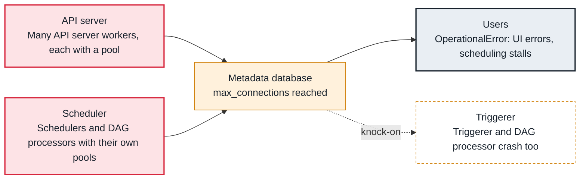

<!-- Generated from data/failures/metadata.js by `node scripts/atlas.mjs docs`. Edit the data, then regenerate. -->

# Metadata database out of connections

Airflow components together open more connections than PostgreSQL allows, so new ones are refused and every component starts failing.

| Kind | Layer | Scope | Interactive |
|---|---|---|---|
| Cause | Metadata database | Any Airflow deployment | [Open in the atlas](../../index.html#/failures/db-connections-exhausted) |

## How it propagates



## Symptom

Logs across components show `FATAL: sorry, too many clients already` or 'remaining connection slots are reserved'. The UI returns errors, schedulers restart, tasks cannot report state.

## Affected component

The **metadata database** refuses connections opened by the **scheduler**, **API server**, **DAG processor** and **triggerer**.

## Root cause

Each Airflow process keeps a SQLAlchemy pool (pool_size plus max_overflow). Multiply by API server workers, schedulers, DAG processor subprocesses and triggerers, and the total passes PostgreSQL's max_connections, especially after scaling out. Long-idle connections that are never recycled make it worse.

## Investigation

1. **Who holds the connections?**

   ```sh
   psql "$AIRFLOW_DB" -c "SELECT application_name, client_addr, state, count(*) FROM pg_stat_activity GROUP BY 1, 2, 3 ORDER BY 4 DESC LIMIT 10;"
   ```

   Look for: Which hosts and components hold most connections, and how many are idle.

2. **What is the limit?**

   ```sh
   psql "$AIRFLOW_DB" -c 'SHOW max_connections;'
   airflow config get-value database sql_alchemy_pool_size
   ```

   Look for: Pool sizes times processes above max_connections.

## Resolution

Put PgBouncer in front of the database in transaction pooling mode (the official Helm chart can deploy it), reduce sql_alchemy_pool_size and max_overflow, and size the database for the number of components. Restart components after the change.

## Prevention

- Always run PgBouncer in front of the metadata database.
- Recompute connection totals whenever you scale components.
- Alert at 80% of max_connections.

Alerts that lead here: `AirflowDbConnectionsHigh` (page).

## Related

- [Metadata database bloat](metadata-db-bloat.md)
- [Scheduler not running](scheduler-not-running.md)

## Runbooks

- [Scheduler not healthy](../runbooks/scheduler-not-healthy.md)
- [Metadata database under pressure](../runbooks/metadata-db-pressure.md)
