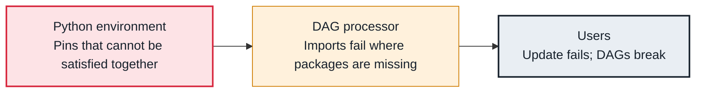

<!-- Generated from data/failures/dependencies.js by `node scripts/atlas.mjs docs`. Edit the data, then regenerate. -->

# Dependency conflict (requirements cannot be installed)

The packages you ask for cannot be installed together, or not with Airflow's own pins, so the environment fails to update and DAGs that need them break.

| Kind | Layer | Scope | Interactive |
|---|---|---|---|
| Cause | Dependencies | Any Airflow deployment | [Open in the atlas](../../index.html#/failures/dependency-conflict) |

## How it propagates



## Symptom

pip fails with `ResolutionImpossible` or 'these package versions have conflicting dependencies'. On MWAA the environment update fails and the requirements log stream shows the error; elsewhere the image build fails, or worse, succeeds with different versions on different components.

## Affected component

The **Python environment** of every component; the **DAG processor** and **workers** then fail to import.

## Root cause

Airflow pins hundreds of packages, published as a constraints file per Airflow and Python version. A requirement that needs a different version of one of them (a newer pandas, an old provider) cannot be resolved. Installing without constraints can succeed but leave Airflow itself with incompatible libraries.

## Investigation

1. **Reproduce the install exactly**

   ```sh
   pip install -r requirements.txt --constraint "https://raw.githubusercontent.com/apache/airflow/constraints-3.0.6/constraints-3.12.txt"
   ```

   Look for: The package pair named in the conflict.

2. **MWAA: read the installation log**

   ```sh
   aws logs tail airflow-$ENV-Worker --log-stream-names requirements_install_ip-10-0-1-15 --since 1h
   ```

   Look for: The pip error from the last update.

## Resolution

Pin to versions inside the constraints file for your Airflow and Python versions; upgrade providers together with Airflow. For a library that truly conflicts, run that task in its own environment: a PythonVirtualenvOperator, a KubernetesPodOperator image, or an ExternalPythonOperator.

## Prevention

- Always install with the constraints file for your exact Airflow and Python versions.
- Build and test the environment in CI before changing production (the MWAA local runner does this for MWAA).
- Isolate heavy or conflicting libraries in their own container.

## Related

- [Broken DAG](dag-import-error.md)

## Runbooks

- [DAG import errors](../runbooks/dag-import-errors.md)
- [Upgrading Airflow](../runbooks/airflow-upgrade.md)
