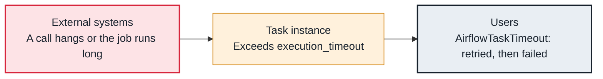

<!-- Generated from data/failures/execution.js by `node scripts/atlas.mjs docs`. Edit the data, then regenerate. -->

# Task timed out (AirflowTaskTimeout)

A task runs longer than its execution_timeout, usually because an external call hangs or a job takes longer than planned, and Airflow stops it.

| Kind | Layer | Scope | Interactive |
|---|---|---|---|
| Cause | Task execution | Any Airflow deployment | [Open in the atlas](../../index.html#/failures/execution-timeout) |

## How it propagates



## Symptom

The task fails with `AirflowTaskTimeout: Timeout, PID: <pid>` after exactly its execution_timeout. Retries may succeed or time out the same way.

## Affected component

The **task** was stopped by its own timeout; the time went into a call to an **external system**.

## Root cause

execution_timeout bounds one try. A query waiting on a lock, an API without a client timeout, a job that grew with the data, or a sensor waiting longer than planned all reach it. Without an execution_timeout, the same task would hold its slot indefinitely instead.

## Investigation

1. **Where did the time go?**

   ```sh
   grep -nE 'INFO|WARNING' task.log | tail -20
   ```

   Look for: The last step logged before the timeout.

2. **Is the external system slow?**

   ```sh
   # warehouse: running queries and locks; API: latency dashboards
   ```

   Look for: A long-running query, a lock, or a slow endpoint at that time.

## Resolution

Fix the slow call (indexes, locks, a client-side timeout shorter than execution_timeout) or size the timeout to the real job. For long external jobs, use deferrable operators that wait in the triggerer instead of a worker.

## Prevention

- Set execution_timeout on every task, sized from history.
- Set client timeouts on every network call inside tasks.
- Track task duration trends and alert on growth.

## Related

- [Sensors hold every slot](sensor-slot-exhaustion.md)
- [Tasks time out calling AWS](aws-endpoint-timeout.md)

## Runbooks

- [Many tasks failing](../runbooks/failing-tasks.md)

## Reproduce it locally

```sh
cp labs/dags/lab_timeout.py $AIRFLOW_HOME/dags/
airflow dags test lab_timeout
```

These run on a local Airflow: see [labs/](../../labs/README.md).
