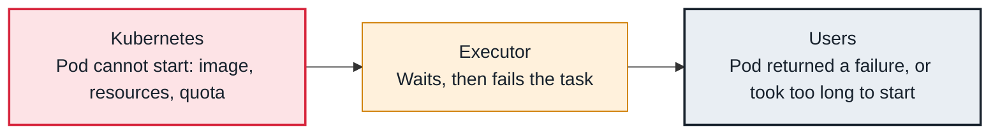

<!-- Generated from data/failures/workers.js by `node scripts/atlas.mjs docs`. Edit the data, then regenerate. -->

# Task pod failed or never started (Kubernetes)

The pod for a task (Kubernetes executor or KubernetesPodOperator) cannot start or exits with an error: a bad image, too few resources, or a missing secret.

| Kind | Layer | Scope | Interactive |
|---|---|---|---|
| Cause | Executors and workers | Any Airflow deployment | [Open in the atlas](../../index.html#/failures/kubernetes-pod-failed) |

## How it propagates



## Symptom

The task fails with `Pod <name> returned a failure` or 'Pod took too long to start', or stays queued until it times out. `kubectl get pods` shows Pending, ImagePullBackOff or CrashLoopBackOff.

## Affected component

The **Kubernetes** pod created for the task cannot start or exits with an error; the **executor** reports the failure on the task.

## Root cause

The pod spec asks for something the cluster cannot give: an image that does not exist or cannot be pulled, more CPU or memory than any node has, a namespace quota that is full, or a secret or volume that does not exist. A container that exits non-zero fails the task.

## Investigation

1. **What state are the pods in?**

   ```sh
   kubectl get pods -n airflow -l dag_id=orders_daily
   kubectl describe pod <pod> -n airflow | sed -n '/Events/,$p'
   ```

   Look for: FailedScheduling, ImagePullBackOff, or container exit codes.

2. **Did the container start, then exit?**

   ```sh
   kubectl logs <pod> -n airflow --previous --tail=50
   ```

   Look for: The application's own error when the image ran but exited non-zero.

## Resolution

Fix the pod spec: the image tag and pull secret, resource requests that fit a node, the namespace quota, missing secrets. Set startup_timeout_seconds sensibly so stuck pods fail fast.

## Prevention

- Pin image digests and test them in CI.
- Set requests and limits per task from measured usage.
- Alert on pods Pending for more than a few minutes in the Airflow namespace.

## Related

- [Tasks stuck in queued](tasks-stuck-queued.md)
- [Task killed for memory](task-oom.md)

## Runbooks

- [Many tasks failing](../runbooks/failing-tasks.md)
