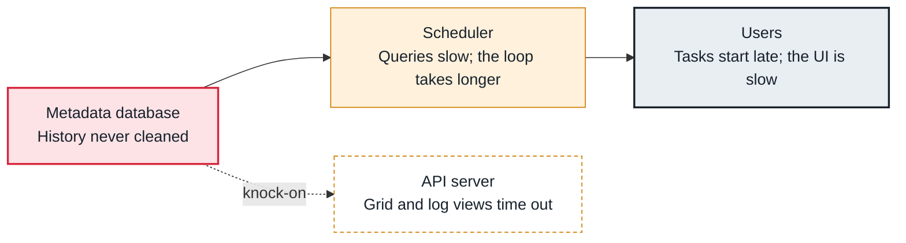

<!-- Generated from data/failures/metadata.js by `node scripts/atlas.mjs docs`. Edit the data, then regenerate. -->

# Metadata database bloat (years of history)

The metadata database keeps every run, task instance, XCom and log line forever unless cleaned, and the scheduler's queries slow down as tables grow.

| Kind | Layer | Scope | Interactive |
|---|---|---|---|
| Cause | Metadata database | Any Airflow deployment | [Open in the atlas](../../index.html#/failures/metadata-db-bloat) |

## How it propagates



## Symptom

Tasks start minutes after their dependencies finish, the scheduler loop duration keeps rising, the grid view is slow, and the database grows by gigabytes a week.

## Affected component

The **metadata database** has grown so large that queries from the **scheduler** and the **API server** slow down.

## Root cause

Every run adds rows to dag_run, task_instance, task_instance_history, xcom, log and more. Nothing deletes them by default. After months, scheduler queries scan far more rows, indexes no longer fit in memory, and vacuum falls behind.

## Investigation

1. **How big are the tables?**

   ```sh
   psql "$AIRFLOW_DB" -c "SELECT relname, n_live_tup, pg_size_pretty(pg_total_relation_size(relid)) FROM pg_stat_user_tables ORDER BY pg_total_relation_size(relid) DESC LIMIT 8;"
   ```

   Look for: Hundreds of millions of rows in task_instance, log or xcom.

2. **Is the scheduler loop slow?**

   ```sh
   # metrics: scheduler.scheduler_loop_duration, dag_processing.total_parse_time
   ```

   Look for: Loop duration in tens of seconds and rising.

## Resolution

Archive and delete old rows with `airflow db clean --clean-before-timestamp <date> --yes` (start with --dry-run and one table at a time), then vacuum. Schedule the cleanup as a maintenance DAG. Move large XComs to object storage.

## Prevention

- Run airflow db clean on a schedule, keeping what you need (for example 90 days).
- Track table sizes and scheduler loop duration.
- Keep XComs small.

Alerts that lead here: `AirflowDbLarge` (ticket).

## Related

- [Large XComs](xcom-too-large.md)
- [Metadata database out of connections](db-connections-exhausted.md)

## Runbooks

- [Scheduler not healthy](../runbooks/scheduler-not-healthy.md)
- [Metadata database under pressure](../runbooks/metadata-db-pressure.md)
