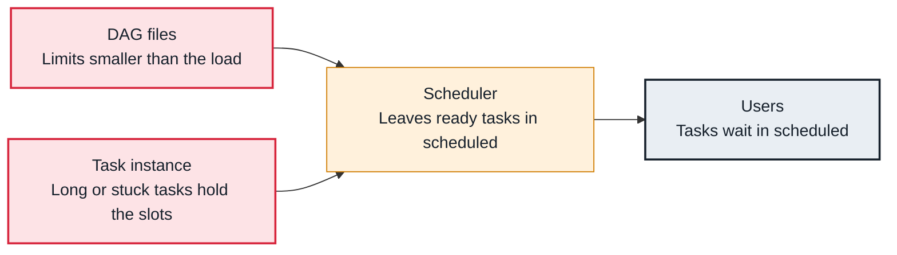

<!-- Generated from data/failures/scheduling.js by `node scripts/atlas.mjs docs`. Edit the data, then regenerate. -->

# Tasks wait for slots (pools and concurrency limits)

Tasks are ready but stay in scheduled because a limit is full: a pool, the DAG's max_active_tasks, or core.parallelism.

| Kind | Layer | Scope | Interactive |
|---|---|---|---|
| Cause | Scheduling | Any Airflow deployment | [Open in the atlas](../../index.html#/failures/pool-slots-exhausted) |

## How it propagates



## Symptom

Tasks sit in scheduled with no errors. Scheduler logs say 'Not scheduling since there are 0 open slots in pool' or that the DAG is at its max_active_tasks limit; the scheduler.tasks.starving metric is above zero.

## Affected component

The **scheduler** enforces the limits; the slots are held by running **tasks**, and the limits come from the **DAG files** and configuration.

## Root cause

Every task needs a slot in its pool (default_pool unless set), room under its DAG's max_active_tasks and max_active_runs, and room under core.parallelism. Long tasks, sensors in poke mode, a backfill or a small pool fill these up; ready tasks then wait.

## Investigation

1. **Which pool is full?**

   ```sh
   airflow pools list
   ```

   Look for: Pools whose occupied slots equal their size.

2. **What holds the slots?**

   ```sh
   airflow tasks states-for-dag-run orders_daily <run_id>
   # UI: Browse > Task Instances, filter state=running, sort by start date
   ```

   Look for: Long-running tasks or poking sensors occupying the pool.

## Resolution

Free or add slots: resize the pool (`airflow pools set warehouse 32 "warehouse queries"`), make sensors deferrable, set execution_timeout so stuck tasks release their slot, and raise max_active_tasks or parallelism only if workers and targets can take it.

## Prevention

- Size pools to what each target system can take, and give each task the right pool.
- Use deferrable sensors so waiting does not use slots.
- Alert on scheduler.tasks.starving and on pools at 100% for long periods.

Alerts that lead here: `AirflowNoOpenSlots` (ticket).

## Related

- [Sensors hold every slot](sensor-slot-exhaustion.md)
- [Tasks stuck in queued](tasks-stuck-queued.md)
- [Catchup flood](catchup-flood.md)

## Runbooks

- [Tasks not starting](../runbooks/tasks-not-running.md)

## Reproduce it locally

```sh
airflow pools set lab_pool 1 "one slot"
cp labs/dags/lab_pool.py $AIRFLOW_HOME/dags/
airflow dags unpause lab_pool && airflow dags trigger lab_pool
airflow pools list
```

These run on a local Airflow: see [labs/](../../labs/README.md).
