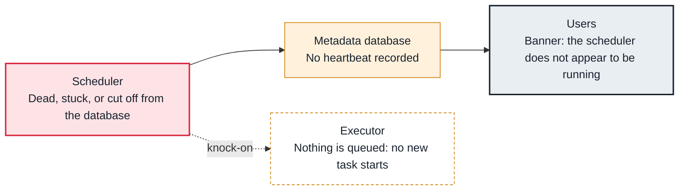

<!-- Generated from data/failures/scheduling.js by `node scripts/atlas.mjs docs`. Edit the data, then regenerate. -->

# Scheduler not running (no heartbeat)

The scheduler process is dead, stuck, or cannot reach the database, so nothing new is scheduled: runs are not created and tasks are not queued.

| Kind | Layer | Scope | Interactive |
|---|---|---|---|
| Cause | Scheduling | Any Airflow deployment | [Open in the atlas](../../index.html#/failures/scheduler-not-running) |

## How it propagates



## Symptom

The UI shows 'The scheduler does not appear to be running. Last heartbeat was received N minutes ago.' No new DAG runs appear and tasks stay in their current state; tasks already running finish normally.

## Affected component

The **scheduler** stopped heartbeating to the **metadata database**, so nothing new is scheduled until it is back.

## Root cause

The scheduler crashed (out of memory, an unhandled error), is stuck on a database lock or a slow query, lost its database connection, or was never started after a deploy. With one scheduler, nothing else takes over.

## Investigation

1. **Is a scheduler alive?**

   ```sh
   airflow jobs check --job-type SchedulerJob --allow-multiple --limit 5
   ```

   Look for: 'No alive jobs found' confirms it.

2. **Read its last log lines**

   ```sh
   kubectl logs deploy/airflow-scheduler -n airflow --tail=100   # or the scheduler log group on MWAA
   ```

   Look for: A crash trace, out-of-memory, or database errors.

## Resolution

Restart the scheduler, then fix what stopped it: give it more memory, fix database connectivity or locks (see the metadata database entries). Run two schedulers so one can fail without stopping scheduling.

## Prevention

- Run at least two schedulers in production.
- Alert on the scheduler heartbeat metric, not only on failed tasks.
- Add a liveness check (airflow jobs check) to the scheduler's container.

## Related

- [Metadata database out of connections](db-connections-exhausted.md)
- [Metadata database bloat](metadata-db-bloat.md)

## Runbooks

- [Scheduler not healthy](../runbooks/scheduler-not-healthy.md)
