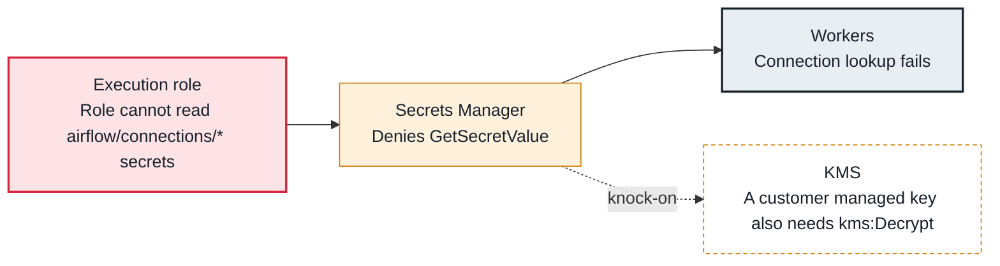

<!-- Generated from data/failures/aws.js by `node scripts/atlas.mjs docs`. Edit the data, then regenerate. -->

# Cannot read connections from Secrets Manager

The Secrets Manager backend is configured, but the execution role cannot read the secret (or decrypt it), so connection lookups fail.

| Kind | Layer | Scope | Interactive |
|---|---|---|---|
| Cause | AWS | On AWS | [Open in the atlas](../../index.html#/failures/secrets-access-denied) |

## How it propagates



## Symptom

Tasks log `is not authorized to perform: secretsmanager:GetSecretValue on resource: ...airflow/connections/warehouse`, often followed by the connection not being found.

## Affected component

The **execution role** cannot read from **Secrets Manager**, or cannot decrypt with the secret's **KMS** key.

## Root cause

The backend reads secrets named <prefix>/<conn_id>. The execution role needs secretsmanager:GetSecretValue on those names (and kms:Decrypt for a customer managed key). A policy scoped to another prefix, or a key policy that excludes the role, denies every lookup.

## Investigation

1. **Which secret name is requested?**

   ```sh
   grep -E 'secretsmanager' task.log | tail -3
   ```

   Look for: The exact secret ARN or name, and its prefix.

2. **Does the role allow it?**

   ```sh
   aws iam simulate-principal-policy --policy-source-arn $ROLE_ARN --action-names secretsmanager:GetSecretValue --resource-arns arn:aws:secretsmanager:eu-west-1:123456789012:secret:airflow/connections/warehouse-AbCdEf
   ```

   Look for: allowed, or the deny.

## Resolution

Allow secretsmanager:GetSecretValue on `airflow/connections/*` and `airflow/variables/*` for the execution role, and kms:Decrypt on the secrets' key. Make sure the backend's prefixes match the secret names.

## Prevention

- Grant the backend's prefixes in the execution role policy, in code.
- Use one prefix convention across environments.
- Test a lookup with airflow connections get after each change.

## Related

- [Connection not defined](connection-not-found.md)
- [AccessDenied from AWS](aws-access-denied.md)

## Runbooks

- [Many tasks failing](../runbooks/failing-tasks.md)
