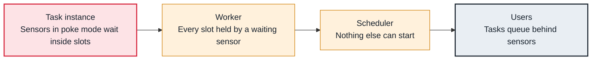

<!-- Generated from data/failures/execution.js by `node scripts/atlas.mjs docs`. Edit the data, then regenerate. -->

# Sensors hold every slot (poke mode)

Sensors in poke mode wait inside worker slots, sometimes for hours, so the slots fill with waiting and real work cannot start.

| Kind | Layer | Scope | Interactive |
|---|---|---|---|
| Cause | Task execution | Any Airflow deployment | [Open in the atlas](../../index.html#/failures/sensor-slot-exhaustion) |

## How it propagates



## Symptom

Most running tasks are sensors logging 'Poking for ...' every minute; other tasks wait in scheduled or queued; pools and worker slots are full even though little work is done.

## Affected component

Sensor **tasks** occupy **worker** slots and pool slots, so the **scheduler** cannot start other work. The **triggerer** is the component that should be doing the waiting.

## Root cause

A sensor in poke mode is a running task that sleeps between checks. Many daily DAGs waiting for upstream files at the same time can hold every slot. Reschedule mode releases the slot between pokes; deferrable sensors hand the wait to the triggerer entirely.

## Investigation

1. **What is running?**

   ```sh
   airflow pools list
   # UI: Browse > Task Instances, state=running: how many are sensors?
   ```

   Look for: Sensors making up most running tasks.

2. **Which mode do they use?**

   ```sh
   grep -rnE 'Sensor\(' dags/ | grep -vE 'deferrable=True|mode="reschedule"'
   ```

   Look for: Sensors without deferrable=True or reschedule mode.

## Resolution

Make sensors deferrable (`deferrable=True` on supported sensors) so the triggerer waits for them; otherwise use `mode="reschedule"`. Give sensors a timeout, and put remaining poke-mode sensors in their own small pool.

## Prevention

- Default to deferrable sensors and operators.
- Set timeout on every sensor.
- Review new sensors in code review for mode and timeout.

## Related

- [Tasks wait for slots](pool-slots-exhausted.md)
- [Deferred tasks never resume](triggerer-not-running.md)

## Runbooks

- [Tasks not starting](../runbooks/tasks-not-running.md)
