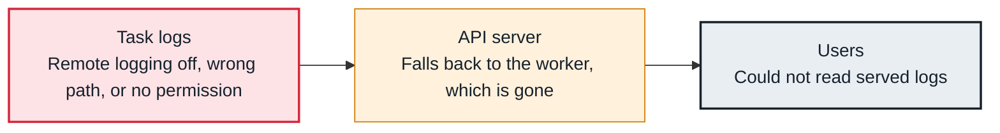

<!-- Generated from data/failures/logs.js by `node scripts/atlas.mjs docs`. Edit the data, then regenerate. -->

# Task logs missing in the UI

The UI cannot show a task's log: remote logging is off or misconfigured, so it asks the worker that ran the task, which is gone.

| Kind | Layer | Scope | Interactive |
|---|---|---|---|
| Cause | Logs | Any Airflow deployment | [Open in the atlas](../../index.html#/failures/task-logs-missing) |

## How it propagates



## Symptom

Opening a task log shows `*** Could not read served logs` or 'No logs found on s3', especially for tasks that ran on a worker or pod that no longer exists. Recent tasks on live workers may show logs.

## Affected component

The **remote log** store has nothing for that try, so the **API server** tries the **worker**, which no longer exists.

## Root cause

Logs reach remote storage only if remote logging is enabled with a valid remote_base_log_folder and connection, and the uploading process can write there. Without it, logs live on the worker's disk and vanish with the worker or pod. A task killed abruptly may never upload its log.

## Investigation

1. **Is remote logging configured?**

   ```sh
   airflow config get-value logging remote_logging
   airflow config get-value logging remote_base_log_folder
   airflow config get-value logging remote_log_conn_id
   ```

   Look for: True, a real bucket or log group, and a connection that exists.

2. **Is anything there?**

   ```sh
   aws s3 ls s3://larder-airflow-logs/dag_id=orders_daily/ --recursive | tail -3
   ```

   Look for: Recent files for that DAG.

## Resolution

Enable remote logging with a bucket (or CloudWatch on MWAA) and give the workers write access and the API server read access. For tasks killed before upload, look at the cause of the kill instead.

## Prevention

- Remote logging on in every non-local environment.
- Alert on upload failures in worker logs.
- Retain logs as long as you need for audits, no longer.

## Related

- [Zombie tasks](zombie-tasks.md)
- [Task killed for memory](task-oom.md)

## Runbooks

- [Many tasks failing](../runbooks/failing-tasks.md)
