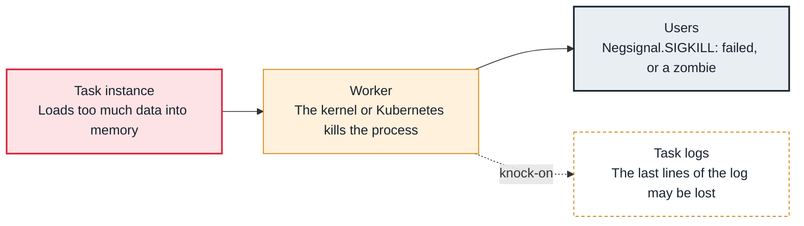

<!-- Generated from data/failures/execution.js by `node scripts/atlas.mjs docs`. Edit the data, then regenerate. -->

# Task killed for memory (Negsignal.SIGKILL)

A task uses more memory than its worker or pod allows, and the kernel or Kubernetes kills it with SIGKILL, often taking neighbouring tasks with it.

| Kind | Layer | Scope | Interactive |
|---|---|---|---|
| Cause | Task execution | Any Airflow deployment | [Open in the atlas](../../index.html#/failures/task-oom) |

## How it propagates



## Symptom

The task log ends with `Task exited with return code Negsignal.SIGKILL` (or -9), or the pod shows `OOMKilled`. Other tasks on the same worker may fail at the same moment.

## Affected component

The **task**'s memory use; the **worker** process or **Kubernetes** pod is what gets killed.

## Root cause

Tasks on a Celery worker share its memory. Reading a whole table into pandas, building large lists, or a memory leak in a long task pushes the worker over its limit, and the out-of-memory killer picks the largest process. On Kubernetes, the pod's memory limit triggers OOMKilled.

## Investigation

1. **Confirm the kill**

   ```sh
   grep -E 'Negsignal.SIGKILL|return code -9' task.log
   kubectl describe pod <task-or-worker-pod> -n airflow | grep -A3 'Last State'
   ```

   Look for: SIGKILL in the task log, or Reason: OOMKilled with exit code 137.

2. **How much does the task use?**

   ```sh
   kubectl top pod -n airflow --sort-by=memory | head
   # or memory metrics of the worker host over the task's run
   ```

   Look for: Memory climbing to the limit during the task.

## Resolution

Process data in chunks or push the work into the system that holds the data (SQL in the warehouse, Spark, Glue). Give heavy tasks their own queue with fewer slots per worker, or a KubernetesPodOperator with a suitable memory limit. Lower worker_concurrency on workers that run heavy tasks.

## Prevention

- Set memory requests and limits per heavy task (Kubernetes) or route them to a dedicated queue.
- Do not move large datasets through Airflow workers; orchestrate the systems that process them.
- Alert on worker memory and on SIGKILL in task logs.

## Related

- [Zombie tasks](zombie-tasks.md)
- [Task logs missing in the UI](task-logs-missing.md)

## Runbooks

- [Many tasks failing](../runbooks/failing-tasks.md)

## Reproduce it locally

```sh
docker run --rm -m 1g -v "$PWD/labs/dags:/opt/airflow/dags" apache/airflow:3.0.6 bash -c "airflow db migrate > /dev/null && airflow dags test lab_memory_hog"
echo "exit code: $?   # 137 is SIGKILL, what a worker sees as Negsignal.SIGKILL"
```

These run on a local Airflow: see [labs/](../../labs/README.md).
