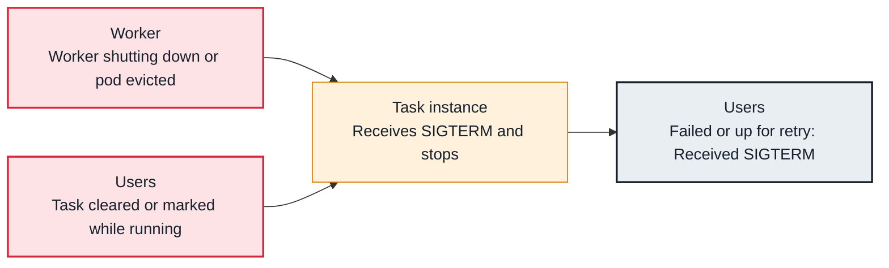

<!-- Generated from data/failures/execution.js by `node scripts/atlas.mjs docs`. Edit the data, then regenerate. -->

# Task received SIGTERM

A running task is told to stop: its worker is shutting down, its pod is being evicted, or someone cleared or marked it while it ran.

| Kind | Layer | Scope | Interactive |
|---|---|---|---|
| Symptom | Task execution | Any Airflow deployment | [Open in the atlas](../../index.html#/failures/task-sigterm) |

## How it propagates



## Symptom

The task log shows `Received SIGTERM. Terminating subprocesses.`, sometimes preceded by 'State of this instance has been externally set to ...'. Several tasks on one worker often stop at the same second.

## Affected component

The **task** was terminated from outside: by its **worker**'s shutdown or by a **user** action.

## Root cause

SIGTERM means someone asked the task to stop. A deploy or autoscaling removed the worker before its tasks finished; Kubernetes evicted the pod (node drain, Spot reclaim, memory pressure); or a user or API call cleared, failed or marked the task while it ran, and the supervisor stops it to match.

## Investigation

1. **Externally changed, or shut down?**

   ```sh
   grep -E 'externally set to|Received SIGTERM' task.log
   ```

   Look for: 'externally set to' means a state change; SIGTERM alone means the worker or pod stopped.

2. **What stopped at that time?**

   ```sh
   kubectl get events -n airflow --sort-by=.lastTimestamp | grep -iE 'evict|kill|scale' | tail
   # and deploy history, and the UI's audit log for clears
   ```

   Look for: A deploy, an eviction or a clear at the same minute.

## Resolution

Make worker shutdowns graceful (Celery warm shutdown with a termination grace period longer than typical tasks), protect worker pods with disruption budgets, and avoid clearing running tasks. Idempotent tasks with retries make the rest harmless.

## Prevention

- Set a termination grace period on workers that covers running tasks.
- Deploy workers with a drain step.
- Retries on every task, with idempotent writes.

## Related

- [Zombie tasks](zombie-tasks.md)

## Runbooks

- [Many tasks failing](../runbooks/failing-tasks.md)
