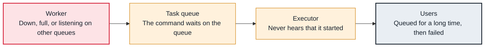

<!-- Generated from data/failures/workers.js by `node scripts/atlas.mjs docs`. Edit the data, then regenerate. -->

# Tasks stuck in queued (no worker picks them up)

Tasks reach queued but never start: no worker listens on their queue, workers are down or full, or the queue itself is unavailable.

| Kind | Layer | Scope | Interactive |
|---|---|---|---|
| Symptom | Executors and workers | Any Airflow deployment | [Open in the atlas](../../index.html#/failures/tasks-stuck-queued) |

## How it propagates



## Symptom

Tasks stay in queued for many minutes; workers look idle. After task_queued_timeout (ten minutes by default) they are failed or rescheduled.

## Affected component

The **executor** handed the task to the **broker** correctly; no **worker** consumed it from that queue.

## Root cause

A Celery task goes to the queue named by its queue argument (default 'default'). If workers listen only on other queues, the task waits forever. Workers that are down, all slots busy, a broker that lost messages, or (on Kubernetes) pods that cannot start have the same symptom.

## Investigation

1. **Which queues do workers consume?**

   ```sh
   celery --app airflow.providers.celery.executors.celery_executor.app inspect active_queues
   ```

   Look for: The task's queue missing from every worker's list.

2. **What is waiting on the queue?**

   ```sh
   redis-cli -h airflow-redis LLEN default
   # MWAA: the SQS queue's ApproximateNumberOfMessagesVisible
   ```

   Look for: A growing queue with idle workers.

## Resolution

Make the task's queue and the workers' queues match (fix the queue argument or start workers with `--queues default,etl`), start or scale workers, and fix the broker if it is unreachable.

## Prevention

- Define queues in one place shared by DAGs and worker configuration.
- Alert on executor.queued_tasks and on tasks queued longer than a few minutes.
- Monitor the broker's queue lengths per queue.

Alerts that lead here: `AirflowQueuedBacklog` (ticket).

## Related

- [Celery broker unreachable](broker-unavailable.md)
- [Tasks wait for slots](pool-slots-exhausted.md)
- [Task pod failed or never started](kubernetes-pod-failed.md)

## Runbooks

- [Tasks not starting](../runbooks/tasks-not-running.md)
