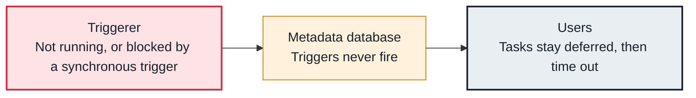

<!-- Generated from data/failures/deferral.js by `node scripts/atlas.mjs docs`. Edit the data, then regenerate. -->

# Deferred tasks never resume (triggerer not running)

No triggerer is running, or it is blocked by a badly written trigger, so deferred tasks wait until they time out.

| Kind | Layer | Scope | Interactive |
|---|---|---|---|
| Cause | Deferral | Any Airflow deployment | [Open in the atlas](../../index.html#/failures/triggerer-not-running) |

## How it propagates



## Symptom

Tasks stay in the deferred state far longer than the event they wait for. The UI warns 'The triggerer does not appear to be running', or the triggerer logs say its async thread was blocked.

## Affected component

The **triggerer** runs the triggers stored in the **metadata database**; deferred **tasks** depend on it to resume.

## Root cause

Deferral hands waiting to the triggerer. If none is deployed (common after enabling deferrable operators on an older setup), it crashed, or a trigger makes blocking calls that stall its event loop, events are never fired and tasks resume only when they time out.

## Investigation

1. **Is a triggerer alive?**

   ```sh
   airflow jobs check --job-type TriggererJob
   ```

   Look for: 'No alive jobs found'.

2. **Is it blocked?**

   ```sh
   kubectl logs deploy/airflow-triggerer -n airflow --tail=200 | grep -i 'async thread was blocked'
   ```

   Look for: Warnings naming a trigger that blocks the event loop.

## Resolution

Run a triggerer (two for availability), and fix triggers that block: use async clients in custom triggers. Restart the triggerer to pick up the waiting triggers.

## Prevention

- Deploy a triggerer wherever deferrable operators are used.
- Alert on the triggerer heartbeat.
- Review custom triggers for blocking calls.

Alerts that lead here: `AirflowTriggererDown` (ticket).

## Related

- [Sensors hold every slot](sensor-slot-exhaustion.md)

## Runbooks

- [Tasks not starting](../runbooks/tasks-not-running.md)
