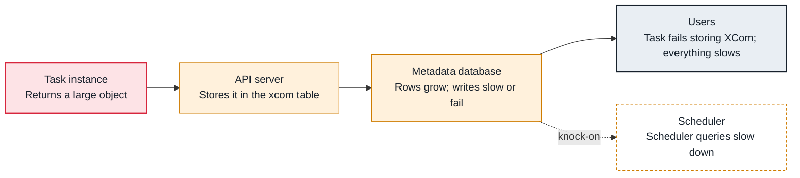

<!-- Generated from data/failures/execution.js by `node scripts/atlas.mjs docs`. Edit the data, then regenerate. -->

# Large XComs (data passed through the metadata database)

A task returns a large object as an XCom, such as a DataFrame or a long list, which is stored in the metadata database, bloating it and failing where size limits apply.

| Kind | Layer | Scope | Interactive |
|---|---|---|---|
| Cause | Task execution | Any Airflow deployment | [Open in the atlas](../../index.html#/failures/xcom-too-large) |

## How it propagates



## Symptom

Tasks fail while pushing XCom (MySQL: `Data too long for column 'value'`), or succeed while the xcom table grows by gigabytes, the database slows and downstream tasks take long to pull.

## Affected component

The **task** pushes the XCom through the **API server** into the **metadata database**.

## Root cause

XComs are meant for small values: IDs, paths, counts. With the default backend they are serialized into a database row. Returning a DataFrame from a TaskFlow function, or a list of millions of keys, stores all of it, per task, per run, and keeps it until cleaned.

## Investigation

1. **Which tasks push the most?**

   ```sh
   psql "$AIRFLOW_DB" -c "SELECT dag_id, task_id, pg_size_pretty(sum(pg_column_size(value))) FROM xcom GROUP BY 1, 2 ORDER BY sum(pg_column_size(value)) DESC LIMIT 5;"
   ```

   Look for: Tasks storing megabytes per run.

2. **What does the task return?**

   ```sh
   grep -nE 'return ' dags/<dag_file>.py   # TaskFlow return values become XComs
   ```

   Look for: A DataFrame, a list of records or file contents returned from a task.

## Resolution

Write data to storage (S3, a table) and pass its location as the XCom. If many tasks need large XComs, configure an object storage XCom backend so values go to S3 automatically. Clean old XComs with `airflow db clean --tables xcom`.

## Prevention

- Review TaskFlow return values: return references, not data.
- Use an object storage XCom backend with a size threshold.
- Track the size of the xcom table.

## Related

- [Metadata database bloat](metadata-db-bloat.md)

## Runbooks

- [Metadata database under pressure](../runbooks/metadata-db-pressure.md)
