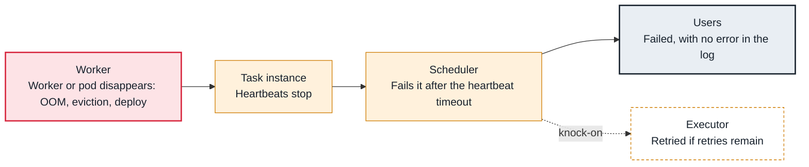

<!-- Generated from data/failures/execution.js by `node scripts/atlas.mjs docs`. Edit the data, then regenerate. -->

# Zombie tasks (heartbeats stopped)

A running task stops heartbeating because its worker or pod disappeared, so the scheduler fails it after the heartbeat timeout, often with nothing useful in its log.

| Kind | Layer | Scope | Interactive |
|---|---|---|---|
| Symptom | Task execution | Any Airflow deployment | [Open in the atlas](../../index.html#/failures/zombie-tasks) |

## How it propagates



## Symptom

Tasks fail or go up for retry while their log simply stops, or the log cannot be fetched at all. Scheduler logs say 'Detected zombie job'; the zombies_killed metric rises.

## Affected component

The **worker** (or pod) running the **task** vanished; the **scheduler** noticed the missing heartbeats and failed it.

## Root cause

A running task heartbeats regularly. If its process dies without reporting (the worker was killed for memory, a pod was evicted or its node removed, a deploy stopped the worker hard), the heartbeats stop and, after the heartbeat timeout (five minutes by default), the scheduler marks it failed. The zombie is the symptom; what killed the worker is the cause.

## Investigation

1. **Confirm and find the host**

   ```sh
   grep -iE 'zombie|not heartbeating' scheduler.log | tail -5
   ```

   Look for: The task, the run and the hostname of the worker.

2. **What happened to that worker?**

   ```sh
   kubectl get pod airflow-worker-2 -n airflow -o jsonpath='{.status.containerStatuses[0].lastState}'
   dmesg -T | grep -i 'killed process'   # on a VM
   ```

   Look for: OOMKilled, an eviction, or a restart at the time the task stopped.

## Resolution

Fix what killed the worker: memory for heavy tasks (see the OOM entry), graceful worker shutdown during deploys, pod disruption budgets for worker pods. Make tasks idempotent so the retry is safe.

## Prevention

- Alert on zombies_killed above zero.
- Give memory-heavy tasks their own queue or pod with enough memory.
- Drain Celery workers (warm shutdown) before stopping them.

Alerts that lead here: `AirflowZombies` (ticket).

## Related

- [Task killed for memory](task-oom.md)
- [Task received SIGTERM](task-sigterm.md)
- [Task logs missing in the UI](task-logs-missing.md)

## Runbooks

- [Many tasks failing](../runbooks/failing-tasks.md)
