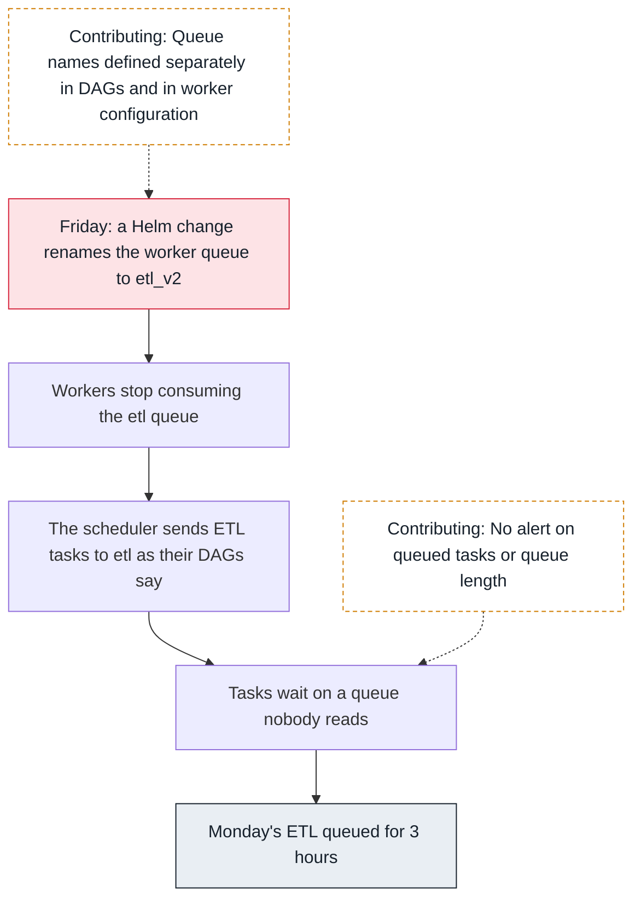
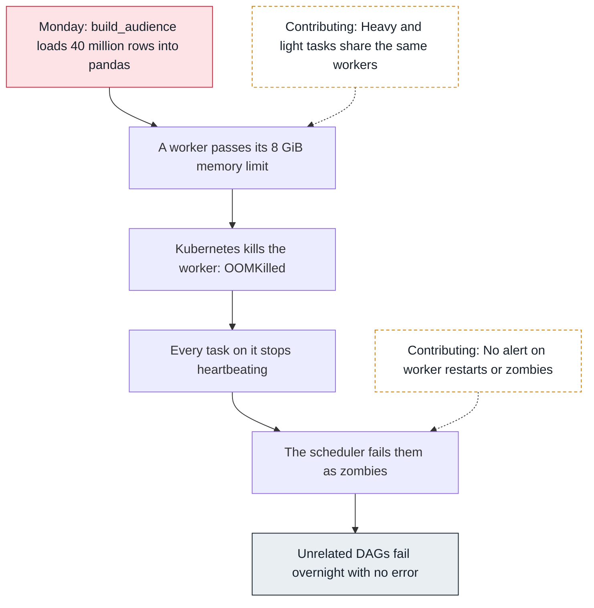
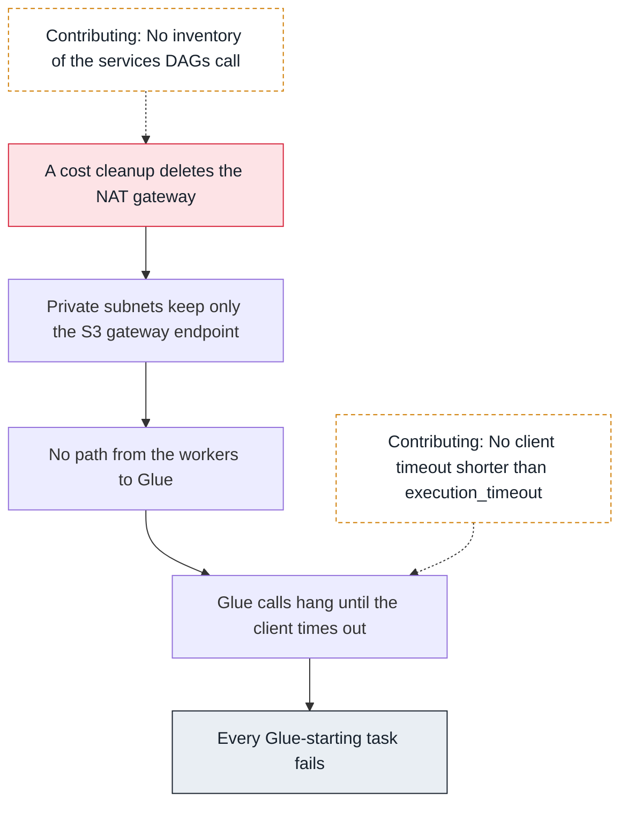

<!-- Generated from data/incidents.js by `node scripts/atlas.mjs docs`. Edit the data, then regenerate. -->

# Incidents

Each investigation starts from what someone noticed and follows dependencies, one hop at a time, until it reaches the change that caused it. [Replay them on the map](../index.html#/incidents).

## Every ETL task queued, nothing running

SEV2, Monday 06:05, Airflow on EKS. The morning ETL has not started. Dozens of tasks across six DAGs sit in queued; the workers report themselves healthy and idle.

### Hop 1: Start with what people see (Users)

```sh
airflow tasks states-for-dag-run orders_daily scheduled__2026-10-12T03:00:00+00:00
```

```text
extract    queued
transform  none
load       none
```

The first task is queued and has been for 3 hours. Next hop: did the scheduler hand it off?

### Hop 2: Did the scheduler queue it? (Scheduler)

```sh
kubectl logs deploy/airflow-scheduler -n airflow --since=4h | grep -A1 'Setting the following tasks to queued state' | head -4
```

```text
Setting the following tasks to queued state:
	<TaskInstance: orders_daily.extract scheduled__2026-10-12T03:00:00+00:00 [scheduled]>
Sending TaskInstanceKey(dag_id='orders_daily', task_id='extract', ...) to CeleryExecutor with priority 3 and queue etl
```

Yes: queued and sent to the Celery queue named etl. The scheduler did its part.

### Hop 3: Is the queue being consumed? (Task queue)

```sh
redis-cli -h airflow-redis LLEN etl
redis-cli -h airflow-redis LLEN default
```

```text
(integer) 187
(integer) 0
```

187 tasks wait on etl; default is empty. Nobody consumes etl.

### Hop 4: Which queues do the workers listen on? (Worker)

```sh
celery --app airflow.providers.celery.executors.celery_executor.app inspect active_queues | grep -o "'name': '[a-z_]*'" | sort | uniq -c
```

```text
      4 'name': 'default'
      4 'name': 'etl_v2'
```

Workers listen on default and etl_v2. Friday's Helm change renamed the worker queue; the DAGs still send to etl.

### Hop 5: Mitigate (Worker)

```sh
helm upgrade airflow apache-airflow/airflow -n airflow --reuse-values --set 'workers.args={bash,-c,exec airflow celery worker --queues default,etl,etl_v2}'
```

```text
Release "airflow" has been upgraded.
etl: 187 -> 0 in 9 minutes
```

Workers consume etl again; the backlog drained and the morning DAGs finished 3 hours late.

**Root cause.** A Helm values change renamed the queue the workers consume, from etl to etl_v2, while DAGs still sent ETL tasks to etl. The scheduler queued them correctly and they waited on a queue no worker read.



- **Mitigate:** Let workers consume etl as well as etl_v2.
- **Fix:** Define queue names once, in a module imported by DAGs and rendered into worker configuration.
- **Prevent:** Alert when executor.queued_tasks stays high or any queue grows for 15 minutes.

## A night of zombies after a new transform

SEV3, Tuesday 02:00 to 05:00, Airflow on EKS. Overnight, tasks across unrelated DAGs failed or retried with no error in their logs. By morning, three reports were late.

### Hop 1: Failures with no error (Users)

```sh
airflow tasks states-for-dag-run billing_daily scheduled__2026-10-13T01:00:00+00:00
```

```text
extract   success
invoice   up_for_retry
notify    upstream_failed
```

The invoice log just stops mid-run. Several other DAGs show the same pattern between 02:00 and 05:00.

### Hop 2: What does the scheduler say? (Scheduler)

```sh
kubectl logs deploy/airflow-scheduler -n airflow --since=8h | grep -c 'Detected zombie job'
```

```text
41
```

41 zombies: tasks whose heartbeats stopped. Something killed the processes running them.

### Hop 3: What happened to the workers? (Worker)

```sh
kubectl get pods -n airflow -l component=worker -o custom-columns=NAME:.metadata.name,RESTARTS:.status.containerStatuses[0].restartCount,LAST:.status.containerStatuses[0].lastState.terminated.reason
```

```text
NAME               RESTARTS  LAST
airflow-worker-0   6         OOMKilled
airflow-worker-1   5         OOMKilled
airflow-worker-2   7         OOMKilled
```

Every worker was killed for memory several times, taking all the tasks running on it.

### Hop 4: Which task eats the memory? (Task instance)

```sh
grep -l 'Negsignal.SIGKILL' logs/**/attempt=1.log | sed -E 's|.*dag_id=([^/]*)/.*task_id=([^/]*)/.*|\1.\2|' | sort | uniq -c | sort -rn | head -3
```

```text
     9 marketing_daily.build_audience
     2 billing_daily.invoice
     1 orders_daily.load
```

build_audience, deployed on Monday, reads 40 million rows into a pandas DataFrame. Each try grows the worker past its 8 GiB limit; the other tasks are collateral.

### Hop 5: Mitigate: isolate the heavy task (Kubernetes)

```sh
# build_audience now runs as a KubernetesPodOperator with 24Gi of memory,
# and the aggregation moved into a warehouse query
```

```text
worker restarts since 11:00: 0
zombies since 11:00: 0
```

The other DAGs stopped failing as soon as the heavy task left the shared workers.

**Root cause.** A new task loaded a large table into memory on shared Celery workers. Each try pushed a worker past its memory limit; Kubernetes killed the worker, and every task on it became a zombie, so unrelated DAGs failed without errors.



- **Mitigate:** Run the heavy task in its own pod with enough memory.
- **Fix:** Push the aggregation into the warehouse instead of pandas.
- **Prevent:** A separate queue for memory-heavy tasks; alerts on OOMKilled workers and zombies_killed.

## Glue jobs time out after a network cleanup

SEV2, Wednesday 03:10, Amazon MWAA. Every task that starts a Glue job fails after hanging for minutes. Tasks that read from S3 still work.

### Hop 1: Read the failing task (Workers)

```sh
aws logs tail airflow-larder-prod-Task --since 1h --filter-pattern ConnectTimeoutError | tail -2
```

```text
botocore.exceptions.ConnectTimeoutError: Connect timeout on endpoint URL: "https://glue.eu-west-1.amazonaws.com/"
```

A timeout, not a denial: the request never reached Glue. Next hop: the network path.

### Hop 2: Is it Glue, or the path to it? (S3, Glue, EMR, Redshift)

```sh
aws glue get-job-runs --job-name orders-transform --max-items 1 --query 'JobRuns[0].[StartedOn,JobRunState]'
```

```text
["2026-10-13T03:02:11Z", "SUCCEEDED"]
```

Glue works from outside the VPC. The problem is between the workers and Glue.

### Hop 3: How do the subnets get out? (NAT or VPC)

```sh
aws ec2 describe-route-tables --filters Name=association.subnet-id,Values=$SUBNET_A --query 'RouteTables[].Routes[].[DestinationCidrBlock,NatGatewayId,GatewayId]'
```

```text
["10.30.0.0/16", null, "local"]
[null, null, "vpce-0s3gateway"]
```

No NAT route any more. Only the local route and the S3 gateway endpoint remain, which is why S3 still works.

### Hop 4: What changed? (Private subnets)

```sh
aws cloudtrail lookup-events --lookup-attributes AttributeKey=EventName,AttributeValue=DeleteNatGateway --max-results 1 --query 'Events[0].[EventTime,Username]'
```

```text
["2026-10-12T17:44:03Z", "network-cleanup-pipeline"]
```

A cost cleanup removed the NAT gateway the evening before, assuming VPC endpoints covered everything. There is no Glue endpoint.

### Hop 5: Mitigate (NAT or VPC)

```sh
aws ec2 create-vpc-endpoint --vpc-id $VPC --vpc-endpoint-type Interface --service-name com.amazonaws.eu-west-1.glue \
  --subnet-ids $SUBNET_A $SUBNET_B --security-group-ids $ENDPOINT_SG --private-dns-enabled
```

```text
VpcEndpoint vpce-0glue... State: pending -> available
```

Retried tasks reached Glue through the new endpoint; the backlog finished by 06:30.

**Root cause.** A network cleanup removed the NAT gateway, assuming VPC endpoints covered all traffic. The environment had no endpoint for Glue, so every Glue call from the workers hung until it timed out, while S3, covered by a gateway endpoint, kept working.



- **Mitigate:** Add an interface endpoint for Glue.
- **Fix:** Keep endpoints for every service DAGs call in the network code, generated from a list owned with the DAGs.
- **Prevent:** A canary DAG that calls each service every hour and alerts on failure.
